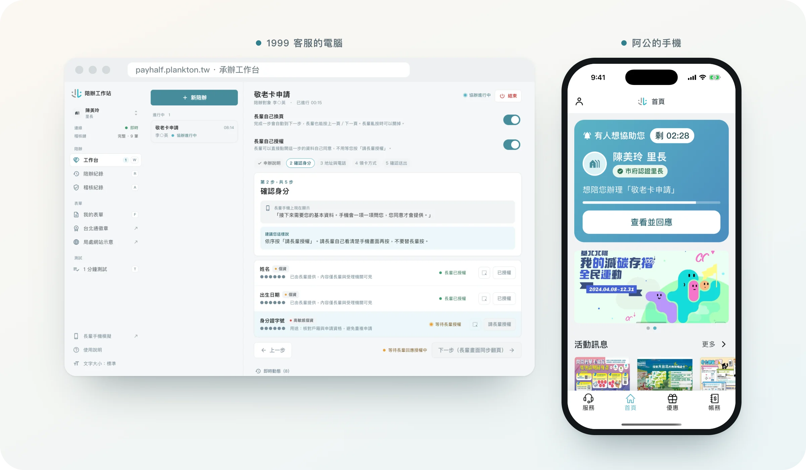
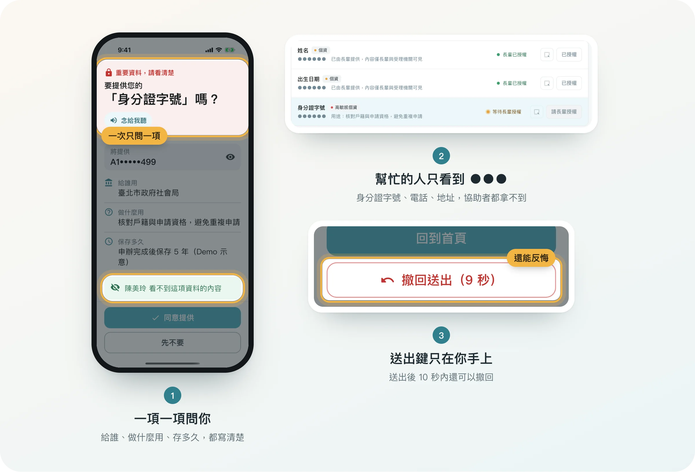
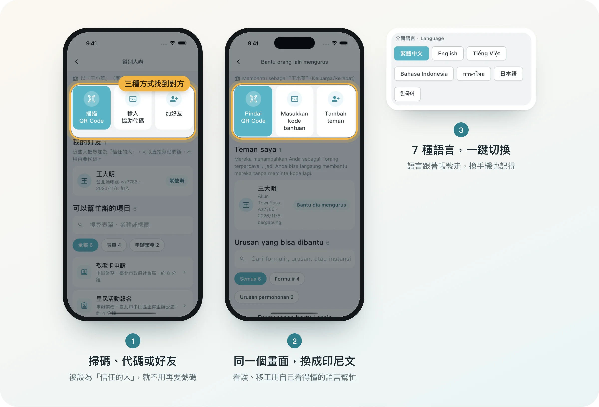
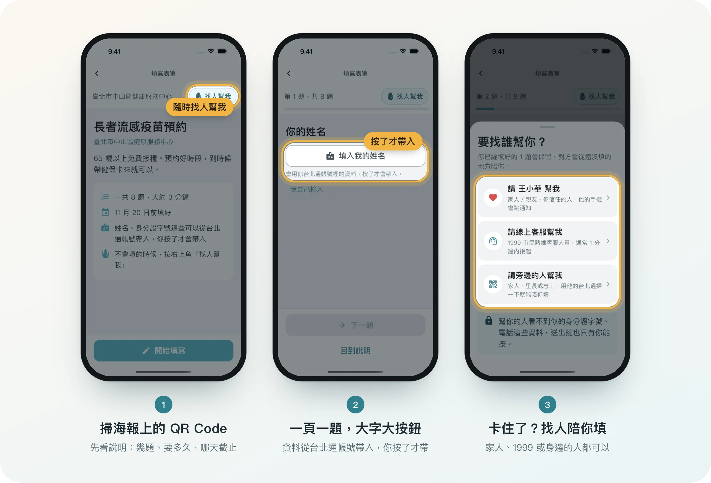
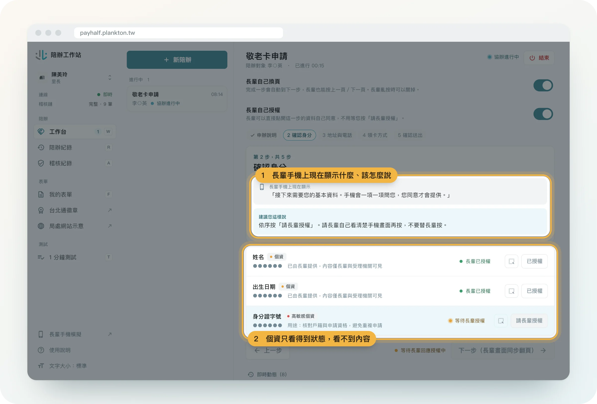
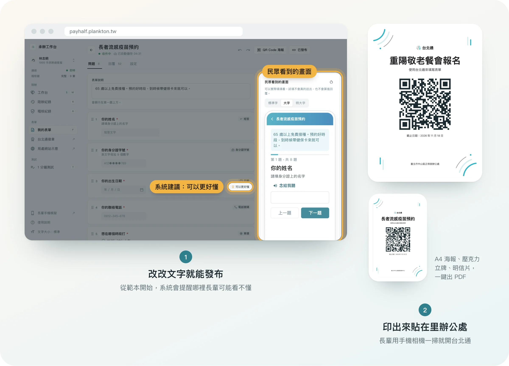
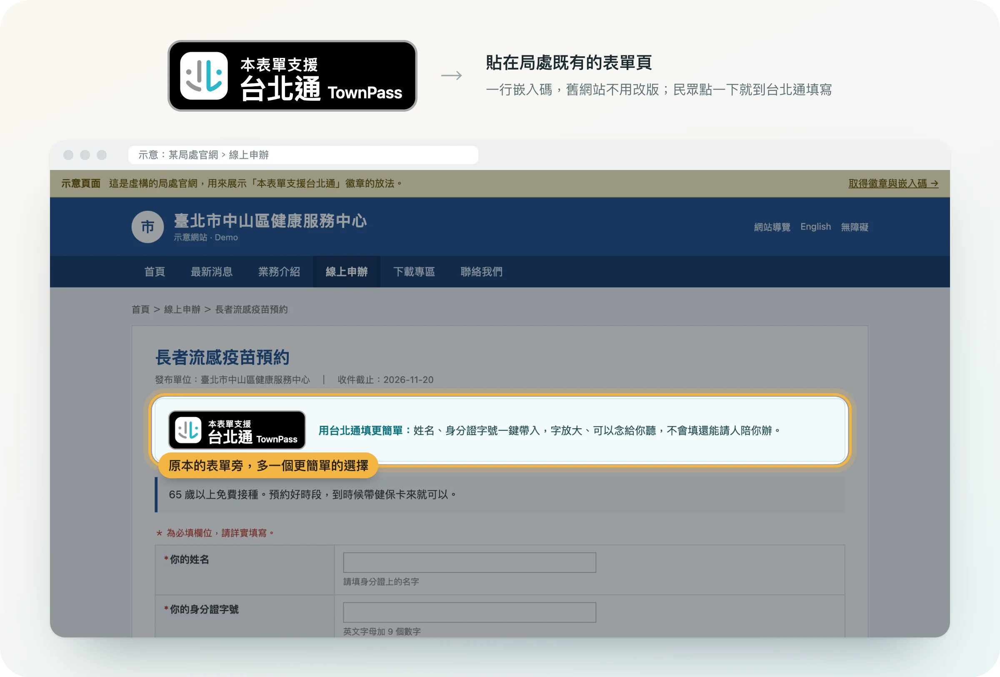

<div align="center">



# 台北通「陪辦」

### 不是介面更簡單，是讓長輩有人陪。

長輩在自己的台北通上辦事，家人、里長或 1999 客服在遠端一步一步陪著。<br>
資料要不要給、申請要不要送，**只有長輩本人能按。**

[**線上體驗**](https://payhalf.plankton.tw/#/demo) &nbsp;·&nbsp;
[局處網站示意](https://payhalf.plankton.tw/demo/agency?form=flu-shot) &nbsp;·&nbsp;
[台北通徽章](https://payhalf.plankton.tw/badge)

</div>

<br>

## 一眼看懂

| | 誰在用 | 原本卡在哪 | 陪辦怎麼解 |
|:-:|---|---|---|
| ① | **長輩** | 看不懂、不會填，家人又不在身邊 | 按一個鍵，就有人遠端陪著填 |
| ② | **長輩** | 怕被騙，不敢把身分證字號交出去 | 每一項資料都先問過，對方看不到 |
| ③ | **家人・看護・移工** | 想幫忙，但語言不通、人不在 | 用自己的手機和語言幫忙 |
| ④ | **所有民眾** | 表單字小、欄位多、找不到入口 | 掃 QR Code，一頁一題、大字、會念 |
| ⑤ | **1999・里長** | 電話裡講半天，看不到對方畫面 | 工作台同步看到進度，不碰個資 |
| ⑥ | **各局處** | 想上台北通，但舊系統不能改 | 後台做表單、印海報、貼徽章 |

<br>

---

<br>

## ① 不會用，就請人陪你辦。

> 王阿公想申請敬老卡。表單看不懂，孫子在外地，里長在辦公室。<br>
> 現在，他只要按一下首頁的「請人陪我辦」。


- **一個按鈕就開始**：首頁就有入口，產生 6 位數號碼給要幫忙的人。
- **遠端也像坐在旁邊**：協助者帶到哪一步，長輩的手機就翻到哪一頁，還可以「念給我聽」。
- **先看清楚是誰**：市府認證的里長、1999 客服會標出來；不認識的人，一鍵拒絕並封鎖。

<br>

## ② 你的資料，只有你能交出去。

> 陪辦最怕的，是變成另一種詐騙。<br>
> 所以我們讓協助者「幫得上忙」，但「拿不到資料」。



- **一次只問一項**：要給誰、做什麼用、存多久，寫在同一個畫面上。
- **協助者只看到 ●●●**：身分證字號、電話、地址都不會出現在對方的畫面或連線裡。
- **送出鍵只在長輩手上**：送出後 10 秒內還能撤回，每一步都留下紀錄。

<br>

## ③ 用你的語言，照顧你在乎的人。

> 在台灣照顧長輩的，很多是來自印尼、越南、泰國的看護。<br>
> 她們最想幫忙，卻常常卡在看不懂中文。



- **三種方式找到對方**：掃長輩的 QR Code、輸入協助代碼，或從好友名單直接幫忙。
- **信任的人免代碼**：長輩把家人設成「信任的人」，下次一按就送到對方手機。
- **7 種語言**：繁中、English、Tiếng Việt、Bahasa Indonesia、ภาษาไทย、日本語、한국어。

<br>

## ④ 掃一下，就能自己填。

> 里辦公處門口的海報、衛生所的立牌，掃一下就打開台北通。<br>
> 會填的自己填；不會填，填到一半也能找人接手。



- **一頁一題、大字大按鈕**：先告訴你一共幾題、大約幾分鐘、哪天截止。
- **按了才帶入**：姓名、身分證字號可以從台北通帳號帶入，但要你自己按。
- **隨時找人幫我**：家人、1999 客服或身邊的人都可以，已經填好的會保留。

<br>

## ⑤ 看得到進度，看不到個資。

> 給 1999 客服與里長的陪辦工作台。<br>
> 不用再在電話裡問「阿嬤，你現在畫面上寫什麼？」



- **同步看到長輩的畫面**：還附上「建議您這樣說」，新進客服也能照著陪。
- **個資只有狀態**：已授權、等長輩同意，一眼看懂，內容永遠是 ●●●。
- **每一步都可追溯**：稽核紀錄用雜湊鏈串起來，任何一筆被改都會被發現。

<br>

## ⑥ 讓每個局處，不改版也能接上台北通。

> 局處不用等新系統，也不用懂程式。<br>
> 今天做好表單，明天就能貼在里辦公處。



- **從範本改起**：邊改邊看民眾手機上的樣子，系統會提醒哪裡長輩可能看不懂。
- **一鍵出海報**：A4 海報、壓克力立牌、明信片，QR Code 都排好了。
- **每份表單都能開放陪辦**：民眾填到一半卡住，承辦人直接接手。

<br>



**「本表單支援台北通」徽章**：局處把一行嵌入碼貼在原本的申辦頁，舊網站完全不用改。
民眾在手機上點一下就打開台北通；在電腦上點，會看到 QR Code，拿手機掃就能接著填。
[取得徽章與嵌入碼 →](https://payhalf.plankton.tw/badge)

<br>

---

<br>

## 安心設計

大家最常問的三件事，我們在程式裡這樣處理：

| 擔心 | 做法 |
|---|---|
| **有人冒充里長來騙** | 配對碼 6 位數、2 分鐘有效、只能用一次。非公務人員會多一行警語。同一人被拒絕 3 次自動封鎖。 |
| **資料被協助者看到** | 協助者收到的每一個 API 回應與即時推播，都經過同一個遮蔽函式。測試會掃描所有回應，確認沒有長輩個資。 |
| **事後說不清楚** | 每個動作寫進雜湊鏈稽核紀錄，只記「發生什麼」，不記個資內容。長輩可在「歷程與授權管理」看到誰幫過他。 |

後端有 35 項自動化測試，涵蓋完整陪辦流程、每一條安全規則、表單與徽章頁面。

<br>

## 自己試試看

1. 打開 [payhalf.plankton.tw/#/demo](https://payhalf.plankton.tw/#/demo)，左邊是承辦工作台，右邊是長輩的手機。
2. 想看局處怎麼接：打開 [局處網站示意](https://payhalf.plankton.tw/demo/agency?form=flu-shot)，點「本表單支援台北通」。
3. 想看長輩實際用的 App：照下方「開發」說明編譯台北通 App。

<details>
<summary><b>示範帳號</b></summary>

<br>

| 角色 | 帳號 | 說明 |
|---|---|---|
| 協助者 | 陳美玲 | 正得里里長，市府認證 |
| 協助者 | 王小華 | 家人親友，非公務人員，長輩端會多一行警語 |
| 協助者 | 林志明 | 1999 客服，市府認證 |
| 長輩 | 王大明 | 1948-03-15，身分證末四碼 7499 |
| 長輩 | 李秀英 | 1951-11-02，身分證末四碼 1634 |

資料全部是虛構的。法令依據與保存期限為示意，正式上線前需由主管機關確認。

</details>

<br>

## 常見問答

評審、市府行政人員、工程師與台北通官方團隊可能會問的問題。條文引用為摘要，正式上線前需由法務單位審閱。

### 為什麼要建在台北通上

**Q：為什麼不做一個獨立的 App 或網頁就好？**

因為陪辦整套邏輯的前提是「確定是誰在按」。我們請教過台北通的技術人員：台北通帳號是經過**實名認證**的，登入的人就是帳號本人。這件事讓陪辦成立：

- **按「同意」與「送出」的，確定是長輩本人。** 授權與送出只接受長輩帳號的 token，而這個帳號背後是實名認證過的真人。所以這份申請就是長輩本人真實、親自的意思表示，等同他自己簽了這份表單，不是別人代簽。
- **來陪的人也有真實身分。** 家人用自己的台北通實名帳號，里長與 1999 客服用市府的帳號。每一次陪辦都記得是誰、什麼身分、哪個單位來陪的，寫進稽核鏈；萬一有爭議，查得到人。
- **資料來源是可信的。** 姓名、身分證字號、生日可以從實名帳號帶入，不用長輩自己打、也不會打錯；需要確認是否設籍臺北市的業務（例如敬老卡），可再由業務機關依法比對戶籍資料。

做成獨立網頁，就只能靠「輸入身分證字號」或簡訊驗證碼確認身分，而這正是詐騙集團最常騙的兩樣東西。建在台北通上，等於直接站在市府已經建好的身分基礎上。

### 法律

**Q：「陪辦」在法律上是代理嗎？里長或客服替長輩按了，申請算誰的？**

不是代理，所以不需要授權書。整個流程裡，申請行為自始至終都在長輩本人已實名認證、已登入的台北通帳號上完成：每一項個資是長輩自己按「同意提供」，最後的「確認送出」也只接受長輩身分的 token（後端會拒絕協助者的 token）。協助者在法律上只是「事實上的協助」，像是坐在旁邊指著螢幕說「按這裡」，送件的法律效果與長輩自己在台北通線上申辦完全相同。依《電子簽章法》，經當事人同意，電子文件可以取代書面；實名帳號讓這份電子文件能對應到真實的本人。

**Q：個資一項一項問，法律依據是什麼？**

- **司法院釋字第 603 號**：資訊隱私權受憲法第 22 條保障，人民有「自主控制個人資料」的權利，包括決定是否揭露、向誰揭露、以何種方式揭露。逐項授權就是把這個權利做成按鈕。
- **個人資料保護法第 5 條**：蒐集不得逾越特定目的之必要範圍。所以協助者看不到內容，只看得到「已授權／等待中」的狀態；系統也不會一次把整份個資交出去。
- **個資法第 8 條**：蒐集前應告知機關名稱、目的、類別、利用期間與方式、當事人權利、不提供的影響。每一個授權畫面都把這六項寫在同一頁（見 `assist_backend/src/data/legal.js`），不是藏在連結後面。
- **個資法第 15、16 條**：公務機關蒐集與利用，須在法定職務必要範圍內或經當事人同意，且不得超出原本目的。每份業務的「用途」寫死在表單定義裡，授權時原樣顯示。
- **個資法第 3 條**：查詢、複製、更正、停止利用、刪除等權利不得預先拋棄。App 的「歷程與授權管理」頁列出每一次誰陪過、同意過什麼，並附上這五項權利的說明。

**Q：長輩按「同意」，真的算有效同意嗎？他可能根本沒看。**

我們不能保證他看了，但盡量讓「沒看就按」變難：一次只問一項，同意鍵放在告知事項下方；畫面有「念給我聽」；按了之後還有 10 秒可以撤回；協助者端同一欄位最多只能請求 3 次，避免反覆跳窗施壓。被拒絕 3 次自動封鎖，是把「不同意」的代價壓到最低。

**Q：無障礙有依據嗎？**

畫面跟著 iOS 動態字型放大到 AX3、主要按鈕至少 56pt、選項整列可點、所有說明可朗讀，對應《身心障礙者權利公約施行法》的可及性要求與 WCAG 2.1 AA 的字級與對比。我們把它當成預設，而不是另開一個「長輩版」。

### 資安

**Q：怎麼防止有人假冒里長騙長輩？**

把「誰可以發起」和「長輩看到什麼」都收緊：

| 威脅 | 作法 |
|---|---|
| 隨機猜配對碼 | 6 位數、2 分鐘有效、只能用一次；每位協助者 10 分鐘內最多試 10 次 |
| 用姓名＋生日猜人 | 每 10 分鐘最多查 5 次；查不到、被封鎖、重複請求時回傳一模一樣的「幽靈請求」，照常倒數逾時，無法從回應分辨存不存在 |
| 假冒公務人員 | 市府認證身分由後端標記，長輩端才會顯示「市府認證里長」；非公務人員會多一行紅字警語與 165 專線 |
| 騷擾、施壓 | 同一欄位最多請求 3 次、同時最多 3 個待回應請求、24 小時內被同一長輩拒絕 3 次自動封鎖，長輩可一鍵封鎖並回報 |

**Q：協助者「看不到個資」是前端藏起來，還是後端根本沒給？**

後端沒給。協助者收到的每一個 API 回應與 Socket.IO 推播，都經過同一個 `helperView()` 函式輸出，敏感欄位的 `value` 固定是 `null`，只剩 `status`。自動化測試會把協助者收到的所有回應與推播序列化後，搜尋示範長輩的身分證字號、電話、地址等字串，有任何一筆出現就測試失敗。

**Q：Token 與連線怎麼做？**

- Token 為 HMAC-SHA256 簽章（`payload.signature`，base64url），驗證用常數時間比對；有效 8 小時。密鑰只存在主機環境變數，不進 git；正式環境應接台北通 SSO，demo 的「選擇示範身分」只是替身。
- 後端只綁 `127.0.0.1`，由 nginx 做 TLS 與 WebSocket 轉發，前面再加 Cloudflare。
- Universal Links 只允許白名單內的 App ID（`IOS_APP_IDS`），QR Code 與徽章只會導向我們自己的網域。

**Q：事後怎麼證明沒有人動過紀錄？**

稽核紀錄只能新增、不能修改，每筆包含前一筆的 SHA-256 雜湊（hash chain），`GET /api/audit/verify` 會從創世區塊重算到最後一筆。紀錄只寫「發生什麼」（誰、何時、哪個欄位、同意或拒絕），不寫個資的值，所以稽核紀錄本身外洩也不會洩露個資。

**Q：Session 結束後資料去哪？**

結束或送出後，session 裡的個資立即清除；閒置 30 分鐘自動結束，最長 60 分鐘。目前所有狀態在記憶體，重啟即清空，這是 demo 的設計選擇；正式上線要換成加密的持久化儲存，並接市府既有的日誌與告警系統。

**Q：有什麼是還沒做的？**

誠實講：demo 環境為了方便評審反覆操作，部分次數上限比上表放寬；掃描器目前會開啟任何 https 網址，正式版應限制在市府網域；表單後台的個資告知欄位目前沿用業務定義，尚未開放承辦人逐份編輯。這些都列在我們的待辦，不影響核心的授權與遮蔽機制。

### 實際使用場景

**Q：為什麼是里長和 1999？**

我們先問了市府的行政人員：長輩手機不會用時，通常不是去找官網說明，而是去找里長伯，或者打 1999。所以我們沒有發明新的求助管道，而是把這兩條既有的路做成按鈕：里長在辦公處可以用自己的台北通掃長輩的 QR Code 面對面陪；1999 客服在電話裡請長輩念 6 位數，就能在工作台上看到長輩的畫面。

**Q：1999 客服本來就會在電話裡教，為什麼還需要這個？**

因為客服看不到長輩的畫面。「阿嬤，你現在畫面上寫什麼？」這句話可以耗掉一通電話的一半。工作台直接顯示「長輩手機上現在顯示」與「建議您這樣說」，而且客服帶到第幾步，長輩的手機就翻到第幾頁，不用口頭描述。我們預期這會縮短通話時間，但還沒有實測數據。

**Q：如果里長直接拿長輩的手機幫他填，不是更快？**

更快，但問題全在事後：里長看到了身分證字號、也按了送出，一旦有爭議說不清楚是誰同意的。陪辦讓里長「看得到進度、看不到個資、按不了送出」，對里長也是保護。

**Q：長輩沒有智慧型手機怎麼辦？**

不是這個功能的對象，仍走臨櫃或紙本。陪辦解決的是「有手機、有台北通，但不會用」的那一群，這群人正在快速變多。

**Q：外籍看護的情境是真的嗎？**

在台灣照顧長輩的，很大一部分是印尼、越南、泰國籍的看護，他們常常是離長輩最近、最想幫忙的人，卻卡在中文。所以協助者端有 7 種語言，長輩端保持中文：看護用印尼文操作，長輩的手機上出現的還是中文的「陳美玲里長想陪您辦理」。

**Q：長輩亂按怎麼辦？**

協助者可以關掉「長輩自己換頁」，畫面就只跟著協助者走；但「不要」、「結束協助」、「撤回送出」永遠在長輩手上，關不掉。

### 生活化的小巧思

- **「念給我聽」不念個資。** 朗讀只念說明、用途與風險提醒，不念身分證字號與電話，在公車上按也不怕旁人聽到。
- **撤回從 5 秒放寬到 10 秒。** 網頁原型設 5 秒，實際讓長輩試了之後發現反應跟不上，改成 10 秒。
- **配對碼顯示成「673 018」。** 三位一組，電話裡念給客服聽比較不會錯。
- **首頁的邀請徽章沒有關閉鈕。** 有人想協助時，首頁最上方出現倒數徽章並發系統通知，回應或逾時才消失，長輩不會滑過去就忘了。
- **身分證字號顯示成 A1•••••499。** 長輩可以確認是自己的，旁人看不到全部，想看再按眼睛圖示。
- **大字時按鈕自己搬家。** 字放大到看不到按鈕時，主要按鈕會移到不用捲動就看得到的位置；兩個選項一律上下排，不會擠成一團。
- **「不要」永遠比「好」容易按。** 拒絕鍵、「我不認識這個人」都在畫面上，不藏在選單裡。
- **先說要多久。** 表單一開始就寫「一共 8 題，大約 3 分鐘，11 月 20 日前填好」，長輩可以決定現在填還是等孫子回來。
- **「按了才帶入」。** 姓名、身分證字號可以從帳號帶入，但一定要長輩自己按，不會悄悄填好。
- **立牌是真的尺寸。** 壓克力立牌固定 9.1 × 14.4 cm，PDF 一律 A4 並帶裁切標記，里辦公處用一般印表機印出來就能放進現成的立牌。
- **徽章在電腦上點會變 QR Code。** 局處網站的訪客多半在電腦前，點了徽章會看到 QR Code，拿起手機掃就能接著填，不用抄網址。

<br>

<details>
<summary><b>開發</b>：專案結構、啟動與部署</summary>

<br>

這個 repo 是 [Town Pass（台北通開源版）](https://github.com/taipei-doit/TownPass) 的 fork。

| 位置 | 內容 |
|---|---|
| `lib/page/assist/`、`lib/service/assist_service.dart` | App 端：請人陪我辦、幫別人辦、掃碼填表單 |
| `lib/util/tp_i18n.dart`、`lib/util/i18n/` | 7 種語言（以繁中原文當 key，沒翻到的字串顯示中文） |
| `assist/assist_backend/` | Node.js 後端（Express + Socket.IO），`npm test` |
| `assist/assist_web/` | Flutter Web 承辦工作台與表單後台 |
| `assist/README.md` | 陪辦功能的完整說明、啟動與部署方式 |

```bash
# 後端（會一併提供承辦工作台網頁）
cd assist/assist_backend && npm install && npm start

# 台北通 App，指定要連的後端
flutter run --dart-define=ASSIST_API=https://payhalf.plankton.tw
```

App 也可以在「設定 › 陪辦伺服器」切換後端。更多細節見 [assist/README.md](assist/README.md)。

</details>

<details>
<summary><b>關於 Town Pass 原專案</b></summary>

<br>

### What is Town Pass?

Town Pass is an open-source project developed by the Taipei City Government. With the growth of smart cities, the demand for digitalization in city management and citizen services continues to rise. As we enter a new digital era, our goal is to involve citizens in the process, combining third-party expertise and innovation to make digital life in Taipei more convenient.

Town Pass is not just an application; it is an open community project. Through open-source, every citizen can participate in the ideation, development, and optimization of the application. This not only enhances citizen engagement and satisfaction but also leverages collective intelligence to continuously improve the application, making it truly serve the people. Furthermore, we hope that various municipalities can widely adopt the open-source framework of Town Pass, integrate it with their existing municipal service systems, and quickly have their own applications to enhance digital governance.

Open source is a key driver of technological progress and social development. Through open-source, Town Pass will become an ever-evolving platform, attracting developers from all backgrounds to contribute. We welcome experts to submit code, report issues, provide suggestions, and even develop new features and creative ideas, working together to perfect Town Pass as we advance toward a smart city.

### Getting Started

We highly recommend to read through our [document](https://townpass.taipei/en/docs/) for more detail.

Here are some quick setup guide.

## Requirement

- [Flutter](https://docs.flutter.dev/get-started/install) or [FVM](https://fvm.app/documentation/getting-started/installation)
- [XCode](https://developer.apple.com/xcode/) (for iOS)
- [Android SDK](https://developer.android.com/studio/index.html) (for Android, with or without Android Studio)

## Build the Project

1. Get the packages project needed:

   ``` bash
   flutter pub get
   ```

2. Generate additional needed dart code for the project.

   ``` bash
   dart run build_runner build
   ```

3. You are all set now, Run the project from your IDE or the through the command line:

   ``` bash
   flutter run
   ```

</details>
